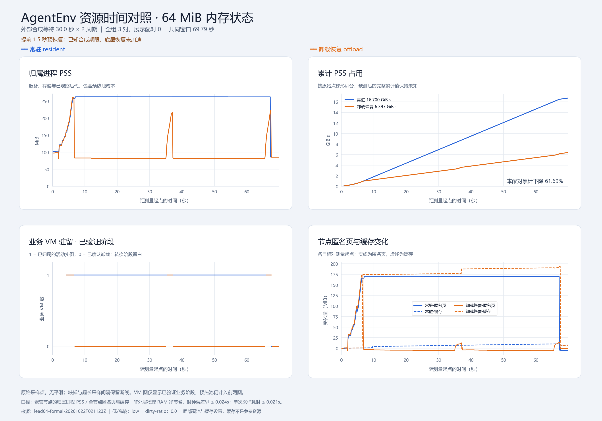

# 64 MiB 沙箱恢复：优化与复验

日期：2026-10-22。**在精确已知 30 秒合成等待期限、提前 1.5 秒恢复的条件下，三对正式任务达到本轮目标：PSS 积分下降 60.72%，任务 p95 增加 0.91%，配对首工具额外等待 p95 为 0.289 秒，6/6 正确且完整清理。**

这是恢复时机的调度收益。底层恢复加完整 RAM 校验仍需 1.845–1.944 秒；对无法提前获知工具到达时间的按需恢复，尚未找到同时达到两个延迟门槛的优化。不能将本结果解释为 VM 恢复本身已缩短到 1 秒内，或真实 LLM 的预测能力已验证。

## 负载与不变条件

remote186 只运行客户端；AgentEnv 和 Firecracker 位于 remote145 承载的专用 Ubuntu 节点。固定 AgentEnv 源码 `a27b2db909b035f58696ba8798ea0e285c7bfa17`、原镜像 digest、1 CPU / 1024 MiB 沙箱、bound1 预热池与相同配置摘要。服务没有重启。环境、镜像、构建及部署步骤见 [总体报告](sandbox_offload_results.md) 和 [复现指南](../scripts/agentenv_offload/README.md)。

业务探针仍实际触碰 **64 MiB** 匿名内存，低熵、dirty-ratio=0，每任务 2 周期，每周期外部等待 30 秒。没有缩小工作集、增加等待时间、降低哈希强度或跳过任何一次全内存校验。RAM-only nonce、进程、文件、打开 FD、计数和副作用去重保持原标准。

## 瓶颈与未奏效的候选

| 轮次 | 控制变量与观测 | 决策 |
|---|---|---|
| `baseline64-recheck-20261022T015234Z` | 未优化按需恢复复验；首工具额外 1.830 秒，任务 +19.94%；offload 创建比常驻慢约 10 秒 | 保留原始失败，初始化波动不能全部归因恢复 |
| `zerocopy64-20261022T015607Z` | 完整 SHA-256 改用 memoryview，消除每 64 KiB 切片复制；首工具 2.133/2.062 秒 | 保留零复制实现，但不将它当作达标原因 |
| `readahead64-20261022T015902Z` | 恢复后仅对明确归属的内存设备将 sysfs 128→1024 KiB；首工具 2.125/2.051 秒 | 未证明现有 mmap 生效，也没有端到端收益；最终代码移除此功能 |
| `fullprefetch64-20261022T020447Z` | 请求后并行 buffered pread 完整 1 GiB VM 内存设备；首工具 2.219/2.150 秒 | 包含预读时间仍未达标；最终代码移除此功能 |
| `lead64-pilot-20261022T020722Z` | 恢复提前 1.5 秒，1 对鉴别；PSS -60.44%、任务 +0.82%、配对额外首工具 0.381 秒 | 固定策略后进入独立三对正式复验 |

零复制、sysfs 与完整预读三个短诊断采用 2 秒等待、单臂、2 周期，不能与 30 秒正式 A/B 合并计算收益。每轮实际代码保存在 `source/`；后两项实验功能只作为历史证据保留，不进入发布的默认实现。File backend、Raw 层、read-ahead 生效时点及候选依据见 [源码与节点调研](sandbox_offload_64m_research.md)。目前证据只定位到恢复后的首次全 RAM 校验区间，尚未分解为可直接归因的内核缺页、CPU 与传输成本。

相较旧轮，最终代码也包含零复制及采样竞态修正，不能把跨轮全部差值仅归因于提前量。正式同一轮 A/B 使用完全相同源码，唯一区别是常驻与显式预恢复策略；每轮源码摘要和实际版本均保留。

## 预恢复调度如何计时

原始工具到达期限始终为 `idle_start + wait_seconds`。offload 在该期限前 1.5 秒开始恢复，并执行原有的完整只读 oracle；到原定期限后才允许 `/tool` 副作用。如果恢复或校验迟到，超出部分仍计入首工具和整任务时间。常驻组保持原来的按需校验与工具路径。

提前恢复、提前校验及提前占回的进程内存都位于整任务与连续宿主采样窗口内。没有把成本挪到测量窗口外，也没有把工具请求起点移到恢复完成之后。

`tool_requested` 事件的写入时刻可能晚于恢复/校验；其 `ready_monotonic_seconds` 才是固定请求期限，`first_tool_seconds` 始终从该期限计算。`restore_oracle_seconds` 表示期限之后的残余等待；真实恢复加全 RAM 校验看 `recovery_to_oracle_seconds`。原始数据同时保留这些字段，避免将残余等待当成纯恢复耗时。

## 三对正式结果

轮次：[`lead64-formal-20261022T021123Z`](../artifacts/agentenv-offload-results/lead64-formal-20261022T021123Z/manifest.json)。[自动分析](../artifacts/agentenv-offload-results/lead64-formal-20261022T021123Z/report.md)、[全部数值](../artifacts/agentenv-offload-results/lead64-formal-20261022T021123Z/summary.json)。

三对顺序由固定 seed 随机安排，6 个已开始任务全部保留。每任务至少 90 秒观察覆盖，各对实际共同积分窗 69.79–70.32 秒，覆盖创建、任务、清理和 I/O 尾段。分位数以独立任务为单位，任务内周期不扩充独立样本数。

| 指标 | 常驻 | 提前恢复的 offload | 结论 |
|---|---:|---:|---|
| 归属进程 PSS 积分，任务均值 | 17.098 GiB·s | 6.716 GiB·s | 三对加权下降 **60.72%**，超过 20% 门槛 |
| 任务 p50 | 67.591 s | 68.026 s | 所有创建、恢复与完整校验均计入 |
| 任务 p95 | 67.635 s | 68.250 s | **+0.91%**，低于 5% |
| 首工具任务 p95 | 0.355 s | 0.624 s | 配对周期差的任务 p95 为 **0.289 s**，低于 1 s |
| 正确与完整清理 | 3/3 | 3/3 | RAM/进程/文件/FD 连续且无重复副作用 |
| vda 写入，任务均值 | 13.428 MiB | 192.201 MiB | 额外 **178.772 MiB/任务**，保留快照成本 |
| vda 读取，任务均值 | 0 MiB | 0 MiB | 暖缓存下单设备观察值，不是零逻辑读取 |

六次 offload 恢复的 API 为 0.426–0.513 秒；API 加 SSH 归属检查为 0.484–0.569 秒；完整恢复至 oracle 为 **1.845–1.944 秒**；原工具期限后的首工具完成为 0.537–0.628 秒。这些相关周期范围不作为独立样本或可靠性保证。

三对分别节省 PSS 61.69%、60.94%、59.55%。主指标包含服务、存储、已观察后代和后台预热 Firecracker 的成本；不能只看业务 VM 消失。每任务 905 个原始样本，最大间隔 0.1001 秒，校准最大误差界 0.024 秒；主轮没有未知进程内存样本或重复身份。采样顺序观测的最长持续时间约 0.031 秒，退出确认不会回推到更早时刻。旧缺样数据保持原样。



四卡片显示第 0 对真实数据，曲线与单对节省率不代替三对统计。图中 PSS 和累计 PSS 展示驻留收益；业务 VM 阶段显示何时释放、何时预恢复；匿名页/缓存展示额外存储成本。原始点不平滑，未知区间留白。另有 [耗时与 I/O 图](../artifacts/agentenv-offload-results/lead64-formal-20261022T021123Z/comparison.png) 和 [矢量资源图](../artifacts/agentenv-offload-results/lead64-formal-20261022T021123Z/resource-cards.svg)。

内层节点匿名页积分均值 18.720→8.104 GiB·s，缓存 463.757→474.124 GiB·s，MemAvailable 2128.967→2139.795 GiB·s。匿名页下降和缓存增加并存；共享缓存和外层嵌套虚拟化尚不能归因为物理 RAM 净节省。分析器的五项进程/任务门槛通过，物理节点归因仍 `unverified`，整体保守状态也保留 `unverified`。

## 清理、验证与复现

独立 `lead64-paused-delete-20261022T022146Z` 在相同 64 MiB 下，恢复、校验、工具完成后再次 pause，再从暂停态直接 DELETE；成功和完整清理均通过。暂停产物、managed snapshot、API、旧 PID、ublk 与全局/私有 namespace 均需核实；不能只确认 API 404。最终只读审计见 `deployment-evidence/optimization-final-audit.json`，预热和共享背景保留供复现。

remote186 Python 3.11 的 47 项后端组件测试通过，另有本地 6 项绘图测试。新增时钟回归覆盖不提前副作用、常驻/默认口径、晚恢复/长 pause 的超支，以及提前恢复失败后的禁止执行与清理。静态检查通过。

```bash
bash /home/zxh/uni-agent-sandbox-offload/code/scripts/agentenv_offload/run_case.sh \
  lead64-recheck both 30 64 2 3 90 --resume-lead-seconds 1.5

# 保持按需恢复的反证对照：默认提前量为 0。
bash /home/zxh/uni-agent-sandbox-offload/code/scripts/agentenv_offload/run_case.sh \
  ondemand64-recheck both 30 64 2 3 90
```

发布目录将原始 metrics/log 按字节压缩进每轮 `raw-data.zip`，保留成员与压缩包摘要；分析前按 [产物说明](../artifacts/agentenv-offload-results/README.md) 解压。源码、结果、事件、清理与汇总可直接查看。准备失败、未奏效候选及先前边界均保留，没有合并到正式成功率。

下一步边界是提前量预测误差、真实模型轨迹、高熵/脏页、并发恢复与冷存储。本轮没有证明这些场景达标，也未实现生产多会话调度器；没有可靠预测期限时，使用默认按需模式并保留约 2 秒级恢复等待的事实。
