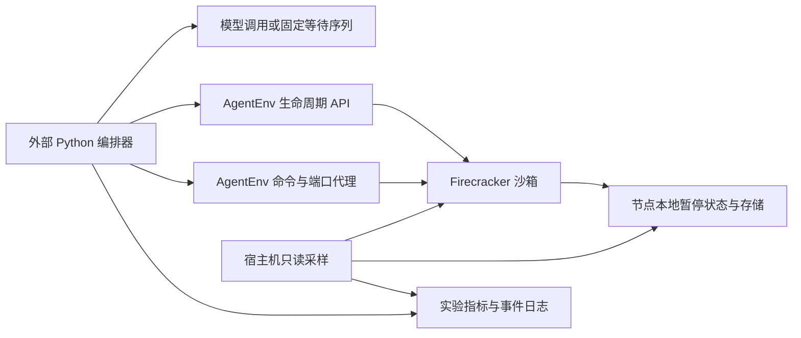
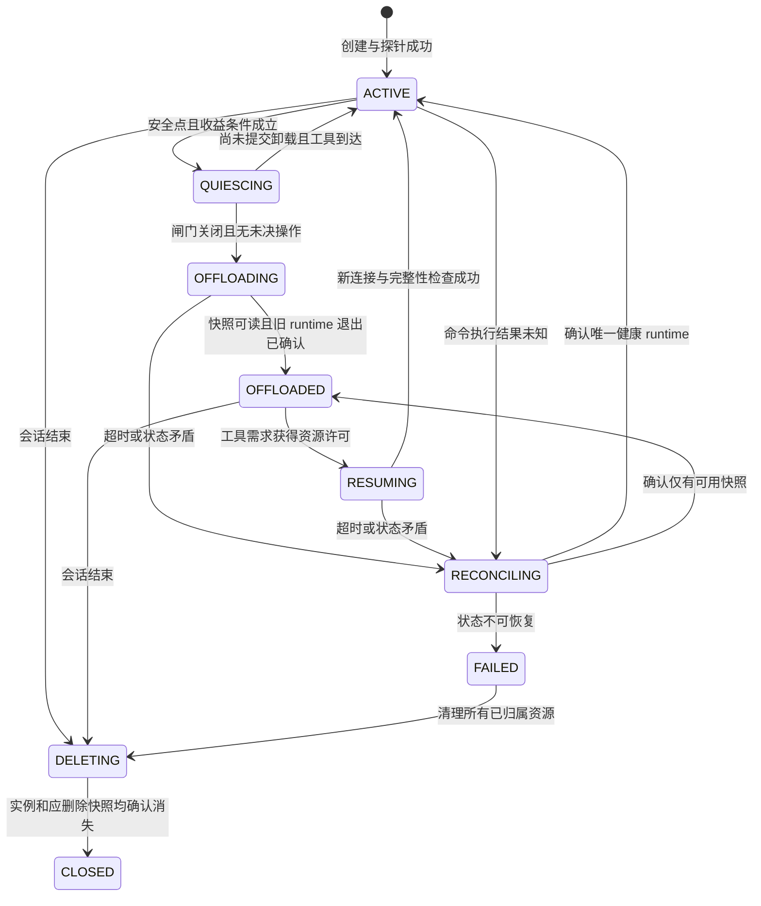

# AgentEnv 沙箱卸载与恢复调度：初版 Demo 设计

日期：2026-10-21。状态：设计基线；独立 Demo 已在 AgentEnv 完成真实对照，结果与范围见 [实测报告](sandbox_offload_results.md) 和 [实验记录](sandbox_offload_experiments.md)。本文中的多会话准入、租约与并发协议仍为生产接入设计，不能因串行 Demo 通过就视为已经实现。

## 1. 结论与本阶段交付

本轮 Demo 唯一后端为 AgentEnv，采用“外部 Python 编排器 + AgentEnv 控制面 + 单个有状态沙箱 + 显式工具边界”。remote186 只运行访问沙箱的 Demo 客户端；AgentEnv 与其创建的 Firecracker 沙箱位于 remote145 承载的专用现代 Linux 节点。常驻组与卸载组运行在该同一部署，先验证单节点、同节点 pause/resume，再扩展等待时长和并发。

- AgentEnv 已有运行态 pause/resume 实现；普通 snapshot 创建完成后源实例仍继续运行，因此 snapshot 成功不等于卸载完成。pause 后仍须确认旧 runtime 已退出、资源已归还，并区分活动资源与包含 paused 实例的配额。
- 本轮不接入 OpenYuanRong/AKernel，不依赖其服务、SDK、release wheel、tunnel 补丁或既有测试脚本；其他社区平台的调研仅保留为背景证据，不作为 Demo 实验组或回退后端。
- 初版由沙箱外编排器处理模型等待和工具请求，沙箱内只运行工具及受控状态探针。现有 mini-SWE runner 的整段长命令路径不接入本轮 Demo，也不把改造生产 runner 作为前置条件。
- 交付包含能力证据、调度协议、可复现 Demo 及五项指标的实测报告；结果以原始 artifact 和 [实验记录](sandbox_offload_experiments.md) 为准，不能将设计预期收益当作已测结果。

配套文档：

| 文档 | 内容 |
|---|---|
| [AgentEnv 能力核实](sandbox_offload_agentenv_research.md) | 固定源码、实际停止路径、资源与持久化边界 |
| [社区方案核实](sandbox_offload_community_research.md) | 保留已完成的社区比较，仅作背景，不决定本轮后端 |
| [Demo 实验规格](sandbox_offload_demo_plan.md) | 常驻与卸载对照、测量口径、完整性检查、重复方法与判定门槛 |

本文中的协议名和参数均为设计草案，不表示现有 SDK 已实现这些方法。

## 2. 必须区分的能力

| 操作 | 保存的状态 | 能否据此认定释放 RAM | 能否据此认定恢复原执行上下文 |
|---|---|---|---|
| 冻结进程或 vCPU | 原 runtime 中的内存继续保留 | 不能 | 解冻可能继续，但外部连接仍可能过期 |
| 文件系统镜像、workspace 备份 | 文件和指定卷 | 只有停止 runtime 后另行确认 | 不能；PID、堆内存、shell 状态可能丢失 |
| 运行态 snapshot | 内存、虚机状态及对应磁盘状态 | 不能；源 runtime 可继续运行 | 依赖快照一致性、版本、网络等约束 |
| 运行态卸载 | 持久化可恢复状态，并终止旧 runtime | 需宿主机及资源账本确认 | 恢复后验证进程、文件、服务和连接 |
| 从快照 fork | 从同一状态创建另一个实例 | 不能 | 是分支，不等于原逻辑会话单实例恢复 |

本设计的 offload 只指第四行。活动 CPU/RAM reservation、物理内存、磁盘存储、租户实例配额和计费是不同的账本，必须分别报告。模型权重和 KV cache 属于推理服务资源，本方案不自动释放它们。

64 MiB 后续验证增加了可选的显式预恢复：仅在工具到达期限可提前获知时，在该期限前启动恢复和只读校验，到期限后才执行副作用。提前占回的资源纳入积分；默认提前量为零。该已知合成期限下的结果见 [64 MiB 报告](sandbox_offload_64m_results.md)，不能视为真实模型预测或多会话调度器已经实现。

## 3. Demo 拓扑与边界

| 组件 | 本轮职责 | 运行位置 |
|---|---|---|
| Python 编排器 | 保存逻辑会话、模型结果、命令队列及状态机；先单会话串行，再以异步任务增加并发 | `remote186`，`/home/zxh`，Conda `uni-agent` / Python 3.11 |
| AgentEnv 控制面 | 创建、查询、pause、resume、删除；保存实例代际与路由 | 独立 AgentEnv 部署 |
| AgentEnv 命令/端口代理及 envd | 每次执行独立工具命令，提供结果与应用访问路径 | AgentEnv 数据通路；不复用现有 SandboxClient |
| 沙箱 | 文件与进程内存探针、闲置状态服务、工具命令 | 初版固定一个 Linux KVM 执行节点 |
| 宿主采样 | Firecracker 进程、cgroup/PSS、ublk/存储服务、page cache、磁盘 I/O 和资源指标 | 实际执行节点；不能由客户端 RSS 替代 |

部署拓扑固定为 remote186 客户端 → 加密网络连接 → remote145 上的专用 AgentEnv 执行节点 → Firecracker 沙箱。remote186 不承载本轮 AgentEnv 服务或实验沙箱；其已有其他任务的虚机不属于本实验。机器内核和嵌套 KVM 预检、专用节点启动情况见 [实验记录](sandbox_offload_experiments.md)。

第一版不引入 Ray、不复用仓库已有沙箱适配器、不改生产 runner。使用固定模型等待序列证明机制，真实模型调用作为后续同一 AgentEnv 路线的负载验证。结果只证明这个独立 Demo；不证明现有整段 agent 长命令已支持安全卸载。

## 4. AgentEnv 版本和接口约束

固定 AgentEnv revision 为 `a27b2db909b035f58696ba8798ea0e285c7bfa17`，与 [能力核实文档](sandbox_offload_agentenv_research.md) 一致。部署时记录服务构建摘要、CLI/客户端版本、Firecracker、内核、ublk/OverlayBD、镜像 digest 和配置摘要，不能只记录 main 或 latest。若改版本，重新核对 API 和释放路径，再比较实验结果。

实际 Demo 由 Python 发起生命周期 HTTP 请求，同一 revision 的 `aenv exec` 负责启动有状态探针；周期工具通过 AgentEnv 私有 HTTP 代理执行文件与计数操作。两组使用相同客户端与参数。恢复指标包含 API、SSH 进程归属检查、完整 RAM 校验和首工具，不把这些总耗时解释为纯 VM 恢复时间，也不将其当作原生 shell 延迟测试。

| 阶段 | 固定版接口 | 完成判断 |
|---|---|---|
| 从模板创建 | `POST /v2/sandboxes`，包含 `templateID`、显式 `timeout` | 201 后继续工具探针；模板决定资源形状 |
| OCI 冷创建，准备阶段备选 | `POST /sandboxes-cold`，包含 `image`、`cpuCount`、`memoryMB`、`timeout`、`secure:true` | 201 后继续工具探针；拉取/转换计入初始化，不混入循环恢复时间 |
| 查询 | `GET /sandboxes/{id}` | 元数据证据；不单独作为就绪/卸载完成证明 |
| 卸载 | `POST /sandboxes/{id}/pause` | 204 加旧 PID 退出、持久记录及资源账本核验 |
| 显式恢复 | `POST /v2/sandboxes/{id}/connect`，包含 `timeout` | Paused 恢复为 201，已 Running 为 200；继续新连接和业务探针 |
| 工具执行 | `aenv exec <id> -- <command> <args>` | 完整 stdout/stderr 和远端退出事件；提前断流按结果未知处理 |
| 删除 | `DELETE /sandboxes/{id}` | 204 后查询不存在并核对本轮资源残留 |

创建方式在一个 A/B 实验块中固定，不把模板启动与 OCI 冷创建混为相同基线。旧 `/sandboxes/{id}/resume` 仍有实现，但 OpenAPI 已标弃用；本 Demo 采用 v2 connect。connect 的 timeout 只延长生命周期，编排器仍单独执行原始任务 deadline，不依赖该字段缩短任务期限。[固定版 OpenAPI](https://github.com/kvcache-ai/AgentENV/blob/a27b2db909b035f58696ba8798ea0e285c7bfa17/src/api/openapi.yml#L1715-L2358)

不使用 `snapshot create → 新建副本` 代替同一逻辑沙箱恢复，也不直接对 Firecracker 发冻结命令。pause 已封装保存状态和停止旧实例，上层只发一次 pause 并检查后置条件，不再额外 kill。[固定 API 实现](https://github.com/kvcache-ai/AgentENV/blob/a27b2db909b035f58696ba8798ea0e285c7bfa17/src/api/impls/sandbox.rs#L1792-L2050)

`aenv exec` 先取得详情中的 `envdAccessToken`，再经 AgentEnv 代理向 `/process.Process/Start` 发送 ConnectRPC protobuf 流，以沙箱 ID 和目标端口 `49983` 路由至 envd；不存在本文自定义的 `/execute` JSON REST。生命周期请求使用 `X-API-Key`；CLI 使用权限 0600 的 `~/.config/aenv/credentials`。凭据只在受限配置或进程内使用，不放到命令参数、事件日志或仓库。[原生命令实现](https://github.com/kvcache-ai/AgentENV/blob/a27b2db909b035f58696ba8798ea0e285c7bfa17/crates/aenv/src/commands/exec.rs#L24-L44)、[CLI 认证](https://github.com/kvcache-ai/AgentENV/blob/a27b2db909b035f58696ba8798ea0e285c7bfa17/docs/src/getting-started/aenv-cli/authentication.md)。

本文的 `execute`、`ensure_active`、operation ID、持久命令账本是拟实现的编排层协议，不代表 AgentEnv 已提供同名接口或幂等保证。CLI 断流后的命令查询/接管能力需另行核验；不能确认时保持 UNKNOWN 并失败，不自动重放。

初版只覆盖同节点恢复，暂停状态保留在该节点 persister；跨节点迁移、节点丢失后的恢复、fork、文件级重建及其他平台切换不进入验收。AgentEnv 能力或环境预检失败时停止该实验并报告原因，不退回其他沙箱服务。

## 5. 控制面和状态机

逻辑 session 由一个外部 owner 持有到任务结束；AgentEnv runtime 可以更换。控制器保存 session 到稳定 `sandboxID` 及当前 `sandboxInstanceId` 的映射，而不是把已连接客户端对象在多个 worker 之间传递。初版由单个 Python 编排进程管理，后续多副本再使用持久存储的版本比较与租约。

取消或过期在任何状态都写入删除意图；在途 pause/resume 先调和，再进入 DELETING，不并发执行互相冲突的 provider 变更。QUIESCING 超时且确认没有外部变更时回 ACTIVE；其余不明状态进入 RECONCILING。图中的边不是绕过这些条件的快捷操作。

最少持久字段：`session_id`、租户、`state`、`state_version`、`owner_epoch`、`runtime_generation`、`sandboxID`、`sandboxInstanceId`、暂停代次、资源许可、当前操作 ID、未决命令 ID、最后安全点、任务截止时间和删除意图。pause 产物由 AgentEnv persister 管理；能观测时记录产物引用/摘要，不假设每次 pause 都返回可公开访问的 snapshot ID。时序指标用单调时钟，跨主机事件另记 UTC 与时钟偏差。

`sandboxInstanceId` 的获取路径需在部署中核验，可由生命周期 hook/内部观测记录；不假设公开 GET 直接提供它。不可见时标记缺测，使用本地 generation 和可验证的宿主 PID 变化管理当前实验的代际，不伪造远端实例 ID。

必须保持四条不变量：同一 session 最多一个可写 runtime；未决命令或文件传输存在时不能 offload；资源许可只有获得退出/释放证据后才归还；命令只向已通过探针的当前 generation 下发。

## 6. 何时卸载、何时恢复

安全信号来自编排器明确发布的工具边界。只有以下条件同时满足才进入 QUIESCING：模型请求已交给沙箱外部执行；上一轮工具结果已完整保存到外部；无执行中或执行结果未知的命令；无文件上传下载、reward、调试连接或必须持续运行的后台任务；后端能力已验证；快照存储预算和恢复资源余量充足。

允许保留经过验证可随虚机恢复的闲置进程，以便验证内存保真。对未知后台子进程、持续写盘服务、数据库未提交事务、不可重连外部连接默认保持常驻，不能仅用前台命令计数为零判断安全。

策略先采用可解释的阈值和迟滞：在安全点等待 `idle_grace`；连续失败触发会话/后端熔断；恢复后至少保持 `min_active_time`，限制每分钟卸载次数。未校准前默认关闭自动卸载，单沙箱实验使用显式触发。达到阈值只是候选条件，不能越过安全检查。

工具请求到达时触发按需恢复；若已经恢复中，所有请求加入同一个有界队列，共享一次恢复结果。未来可试预测性提前恢复，但必须作为独立实验分支，不混入初版收益。恢复完成的定义是新 runtime、命令通道、端口与首条业务命令可用，而不是 resume API 返回。

provider 的 TTL autoPause 必须关闭或纳入同一安全点/续租协议，不能在业务忙碌时自行暂停；代理 autoResume 也必须关闭或经过同一准入队列，避免绕开恢复预算。健康探针和指标采集在 OFFLOADED 时只查询外部元数据，不访问会触发自动恢复的端口。后台 warm pool 补货纳入独立资源预算并固定实验配置。

工具与 offload 同时发生时：用状态版本把“登记命令并取得活动许可”和“关闭命令闸门并确认未决数为零”互斥执行。尚未提交 provider 卸载时可取消；提交后先完成或调和卸载，再恢复，不在同一实例上并发 pause/resume/run。

## 7. 命令下发与在途保护

建议逻辑调用为 `execute(session_id, command_id, expected_generation, deadline, command_spec)`，这是控制面协议草案，不是 SDK API。执行顺序如下：

1. 持久登记请求 ID、命令摘要、截止时间和结果位置；不记录凭据。相同 ID/摘要的请求合并，ID 相同但摘要不同直接拒绝。
2. `ensure_active` 取得单次恢复结果和当前 generation；在持锁的状态更新中登记该命令为未决。状态变更后旧 SDK 句柄和端口地址失效。
3. 通过当前连接下发，记录 provider 的 command/process ID。初版同一 session 串行执行命令，跨 session 并发；并行工具以后按明确资源与写冲突规则开放。
4. 只有取得远端退出状态并完整保存输出后，才归还命令许可。外层协程取消或 `asyncio.to_thread` 超时不会证明远端已经停止。
5. 断链后查询远端命令状态与输出游标；不能查询或不能确定副作用时，标为 UNKNOWN，保持保护并调和。没有服务端持久去重/结果账本时，不承诺任意 shell 命令 exactly-once，也不自动重放未知结果的命令。

`expected_generation` 是调用方看到的 runtime 映射版本。仅尚未派发的排队请求，可在持锁确认后绑定恢复完成的新 generation；已经发出或结果未知的旧代命令必须调和原执行，不能自动改绑新代并重新运行。旧代迟到的成功回报也不能释放新代的命令许可。

epoch 能阻止旧 owner 经统一网关继续派发，但如果 provider 不检查 fencing token，它本身不能撤销已经发出的请求。owner 切换前必须确认旧请求/旧 runtime 终止，或隔离该 session；不能仅靠租约过期就并行恢复第二个可写副本。

## 8. 卸载与恢复的提交条件

卸载依次执行：关闭命令入口 → 确认安全点 → 调用 AgentEnv 控制面 pause → 观察 Paused 元数据及对应持久记录 → 确认旧 Firecracker 进程已退出 → 核对 active 资源下降及宿主内存变化 → 记录 OFFLOADED。一致快照、持久化和旧 runtime 停止由 AgentEnv 完成；编排器不额外调用 kill，不绕过控制面操作底层虚机。

AgentEnv 已发现 pause 元数据写入和停止 runtime 失败处理之间的窗口，因此仅凭 204 或 Paused 状态不足以归还资源许可，详见能力核实文档。没有物理侧观测时可以报告“provider 声称释放 reservation”，不能报告实测 RAM 已回收。普通 pause 的节点本地持久化也不能自动提供跨节点灾备。

公开详情的 state 是简化视图：Pausing、Snapshotting、Forking 也可能显示为 `paused`，Resuming 等过程可能显示为 `running`。本方案状态机保存在编排器中，转换完成须结合操作结果、宿主 PID、资源账本及工具探针，不能只轮询 GET 的字符串。[固定状态映射](https://github.com/kvcache-ai/AgentENV/blob/a27b2db909b035f58696ba8798ea0e285c7bfa17/src/api/impls/sandbox.rs#L104-L113)

观测使用 `GET /health` 检查控制面，`GET /metrics` 获取节点指标；启用 observability 后用 `GET /nodes`、`GET /nodes/{id}` 获取节点和 active/paused 资源信息。未启用时空列表或 404 是缺少观测能力，不是零占用。guest 指标不能替代宿主 PSS/cgroup 观测；节点磁盘容量也不能替代 `/proc/diskstats`、`io.stat` 等磁盘 I/O 计数。卸载期间不向 guest 发探针。

恢复依次执行：核对节点、暂停记录和镜像依赖 → 取得 CPU、RAM、I/O 和恢复并发许可 → 记录编排层 operation ID 并发出 AgentEnv 恢复请求 → 查询状态并调和是否已有新实例 → 更新 `sandboxInstanceId`、generation 与 endpoints → 重新获取当前访问信息并建立 envd/端口代理连接 → 验证进程内存、文件及状态服务 → 允许业务命令。operation ID 用于本地关联，除非验证服务端支持，否则不当作远端幂等键。

初版采用独立工具命令，必要的 cwd/env 作为命令参数明确传入；受控内存探针负责证明进程连续性。如果测试长期 shell，则必须重连/接管原 shell 并校验其会话 ID、cwd、env 和上下文，新建 shell 不计作原 shell 无损恢复。TCP/HTTP/WebSocket 连接按可失效处理，不假设内存快照能够保持远端连接存活。

任务墙钟超时、外部授权有效期和服务租约不会因为 guest 暂停自动冻结。恢复队列必须使用原始任务 deadline；不能每次重试重置截止时间。快照可能含进程凭据，必须受租户隔离、访问权限、存储加密及保留期管理，调研和日志只记录元数据，不导出其内容。

## 9. 失败回退

| 故障 | 处理 | 禁止的推断 |
|---|---|---|
| 不支持 offload 或状态探针不通过 | 保持常驻，记录具体能力缺口 | 从方法名或兼容接口推断可用 |
| 快照失败且旧 runtime 明确仍健康 | 丢弃未提交快照引用，恢复入口，暂时禁用卸载 | 不明状态直接继续命令 |
| pause 超时、停止失败或返回状态矛盾 | RECONCILING；保留活动资源许可，查实例/进程及快照 | API 超时代表请求未发生；Paused 代表物理停止 |
| 恢复容量不足 | 有界排队、带随机扰动的有限退避、优先已有任务；过 deadline 明确失败 | 未获得容量就启动新实例；无限重试 |
| resume 超时但可能已创建实例 | 按操作 ID 和实例归属查询，复用唯一成功结果 | 再次无条件创建第二个副本 |
| 快照损坏、过期或节点丢失 | 有可验证备用快照才恢复；否则任务失败 | 用空白重建冒充无损恢复 |
| 非幂等命令结果未知 | 查询/接管原命令；仍不明则隔离并失败 | 自动重放可能已生效的命令 |
| cleanup 失败 | 保留资源/快照引用与删除意图，有限重试并报告残留 | 清空本地句柄就当清理成功 |

业务明确接受文件级重建时，可启动新的独立 attempt 并重新评估任务；此类降级单独计入成功率、状态损失和耗时，不能冲抵无损恢复失败。任务取消期间晚到的恢复成功结果也必须被纳入归属清单并清理。

## 10. 并发和容量账本

| 控制项 | 包含的状态或资源 |
|---|---|
| `max_sessions` | ACTIVE、OFFLOADED、恢复/调和中会话；只有任务真正完成才结束逻辑 slot |
| `max_resident_resources` | 创建/恢复预留 + 正在运行 + 未确认停止的 CPU/RAM；按每节点可放置量核算 |
| `max_inflight_creates` / `max_inflight_resumes` | 分开限制 API 操作，但共享 resident 资源预算，避免两个池共同超卖 |
| `max_inflight_offloads` | 限制快照 CPU、磁盘和存储带宽竞争 |
| `max_snapshot_bytes` / `max_offloaded_sessions` | 持久存储、暂停实例配额和保留期 |
| `max_pending_commands` | 外部队列、输出缓存和请求 deadline，防止把内存压力转移给 driver |

恢复优先于新建，但用租户公平队列、等待时间提升优先级和限额防止饥饿。为恢复保留容量余量；不能将所有卸载释放的空间填满新 session 后再等待无处恢复。若允许通过卸载其他实例腾位置，必须仍满足安全点，并限制置换次数，避免互相恢复/卸载振荡。

AgentEnv 有包含 paused 实例的配额，必须单独纳入准入。逻辑会话上限、活动虚机上限和 tenant 配额不能合并为一个 `live` 数。容量从本次 AgentEnv 节点资源与配额重新测量，不能沿用 其他后端历史实验 的 live 数或创建并发配置。

## 11. 收益模型与适用边界

设本轮外部模型等待长度为 `I`，安全点宽限期为 `g`，卸载到确认资源释放为 `S`，按需恢复排队到首命令可用为 `R`。采用在模型完成后按需恢复的初版策略，实际可卸载等待窗口近似 `W=max(0,I-g-S)`。没有容量竞争时，任务新增等待约为 `max(0,g+S-I)+R`；策略未触发或在提交前取消时不套用此公式。恢复也可能通过缓解竞争降低其他队列延迟，因此最终结论以整任务配对测量为准。

资源收益用每个完整任务的宿主侧 `GiB·s` 积分差计算：`saving = integral(M_resident)-integral(M_offload)`。`M_offload` 必须包含相关 runtime、快照服务和 page cache 的可归因开销，覆盖恢复和延长的任务尾部；不能只挑暂停期间的低点。活动 reservation 的 `GiB·s`、物理内存积分和运行计费分别计算。

先施加成功率、状态完整性和恢复/任务延迟上限，再判断内存收益及磁盘预算。若需要货币化，可用 `memory_value*saving - io_price*extra_io - storage_price*retained_byte_time - cpu_price*extra_cpu - latency_penalty`；价格和延迟权重未知时只报告原始量及盈亏边界，不给虚构回本时间。

较可能适用：模型等待较长、工具调用呈间歇性、沙箱驻留内存大、快照增量较小、存储吞吐有余量、恢复尾延迟在任务预算内。较不适用：短而密集的工具调用、大量脏页、持续外联、后台服务要求不停机、同步恢复洪峰、严格交互延迟、快照与推理共享繁忙磁盘。RAM 降低但任务变慢时应报告真实权衡，不默认判为优化。

## 12. 下一阶段的执行顺序和停止条件

先做一个沙箱的能力与状态完整性探针：进程内存随机标记、文件增量、shell 状态、闲置服务及端口重连；确认 old runtime 停止以及资源账本变化。再做同后端常驻与显式 offload 的配对对照，最后才加策略阈值和并发压力。不能以不同 provider 的常驻结果与卸载结果直接比较收益。

后续客户端验证保留 `remote186`、工作目录 `/home/zxh`、Conda `uni-agent` / Python 3.11；AgentEnv 服务与 `aenv` 不依赖该 Python 环境。服务端按固定版本部署在可观测的 Linux KVM 节点，预检宿主内核 6.8+、`/dev/kvm` 可访问性、CPU 架构、`ublk_drv`/daemon、Firecracker/guest kernel/工具镜像及 OverlayBD 依赖、设备和网络权限、磁盘空间/inode。该 revision 的 OverlayBD 工具为 `v1.0.18-aenv.1`，其余依赖按同 revision 的 manifest 固定。[官方准备条件](https://github.com/kvcache-ai/AgentENV/blob/a27b2db909b035f58696ba8798ea0e285c7bfa17/docs/src/getting-started/quickstart.md#L3-L17)、[依赖清单](https://github.com/kvcache-ai/AgentENV/blob/a27b2db909b035f58696ba8798ea0e285c7bfa17/config/deps_manifest.toml)。

默认使用同节点本地持久存储，不把对象存储或多节点调度纳入最小 Demo。安装和设备配置需要相应管理员权限；运行用户按固定版文档核对 `CAP_NET_ADMIN`、`CAP_SYS_ADMIN` 及 KVM/ublk 权限，不假定普通 Conda 环境已满足宿主权限。[权限实现](https://github.com/kvcache-ai/AgentENV/blob/a27b2db909b035f58696ba8798ea0e285c7bfa17/src/privileges.rs#L18-L43)

本轮已限定为 AgentEnv，仓库中针对 OpenYuanRong 的 SDK 安装、443 tunnel 修补及旧 `test_sandbox.py` 验证条目不作为本 Demo 的依赖或验收门槛；不修改仓库通用规则，也不要求先跑通另一后端。

最终验收改为 AgentEnv 完整生命周期：创建 → 原生命令 → 启动最小 8000 状态服务及内存/文件探针 → 安全点 pause → 确认旧进程退出与资源释放 → 同节点恢复 → 重连 AgentEnv 数据通路 → 校验原状态与 8000 内外健康 → 首工具成功 → 删除并确认本轮实例、暂停记录、设备/网络资源无残留。它是待实现的验收规格，当前不存在已完成的新测试脚本。第一版不依赖 swe-rex；后续真实工具负载可以在同一 AgentEnv 沙箱中加入它。

remote186 只作为客户端；宿主内存和磁盘指标在独立 AgentEnv 执行节点采样，再传回 remote186。看不到执行节点指标时，物理收益结论必须标为证据不足。外层 remote145 的 QEMU 指标另外记录，不与内层节点指标混加。

实验详细分组、指标、建议验收门槛和复现清单见 [Demo 实验规格](sandbox_offload_demo_plan.md)。能力不成立、状态丢失、重复副作用、无法确认旧 runtime 停止、不可归因的资源数据均是停止扩大实验的理由。下一阶段应先形成原始数据，再决定生产实现；本阶段不声称已交付可执行 Demo 或已证明性能收益。
