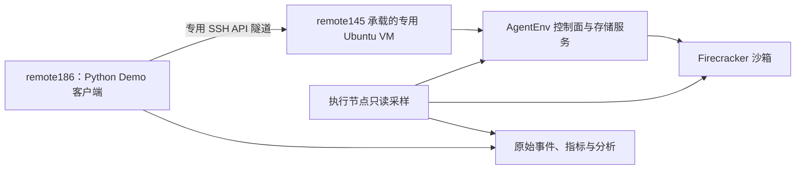
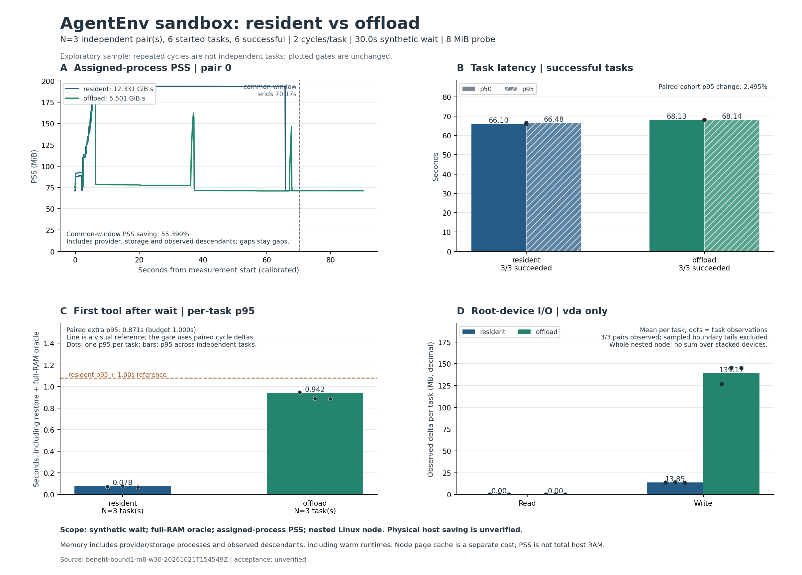

# AgentEnv 卸载与恢复 Demo：实测结果

实验日期：2026-10-21 UTC（本地时间跨至 10-22）。本轮已开发独立 Demo 并完成真实 AgentEnv 对照。**在已测的小状态、长等待场景，归属进程 PSS 内存时间积分下降 56.54%，任务 p95 增加 2.49%，配对首工具额外等待 p95 为 0.871 秒；6/6 任务正确且完整清理。** 代价是快照写入与页缓存增加；节点物理内存净节省仍未验证。

2026-10-22 的 [64 MiB 后续复验](sandbox_offload_64m_results.md) 已在**已知期限、提前 1.5 秒恢复**的条件下达到 PSS -60.72%、任务 p95 +0.91%、首工具额外 p95 0.289 秒；底层恢复加完整校验仍需约 1.9 秒。本文保留先前按需恢复结果，不能将预恢复与底层恢复加速混为一谈。

本结论限定到下述负载与配置。每组仅 3 个独立任务，不构成生产可靠性或尾延迟 SLA，也未证明并发承载量提升。

## 部署与测量口径



remote186 不承载本轮沙箱。其客户端位于 `/home/zxh/uni-agent-sandbox-offload`，使用 Conda `uni-agent` 的 Python 3.11.15。remote145 上专用外层节点为 8 vCPU、32 GiB、100 GiB 稀疏盘，Ubuntu 24.04、内核 6.8.0-147-generic；没有升级共享宿主内核或重启共享机器。

| 固定项 | 实际配置 |
|---|---|
| AgentEnv 源码 | `a27b2db909b035f58696ba8798ea0e285c7bfa17`；服务报告 `0.2.3` / `a27b2db`，不以版本号替代源码核对 |
| 构建 | Rust/Cargo 1.99.1，原生 release 构建 |
| 运行依赖 | Firecracker 1.15.1-patch-v1、guest kernel 6.1.175、tools 0.1.1、OverlayBD v1.0.18-aenv.1 |
| 业务沙箱 | 1 CPU、1024 MiB；同节点恢复；关闭自动恢复与自动暂停，有界 TTL |
| 镜像 | `docker.io/library/python@sha256:8fb0b110b022c70cbe09d3ff1fb313654f31f9c814abb0d48180af56d906a199` |
| 固定背景池 | 全局 low/high=1/1；Firecracker 预热开启、fill concurrency=1；block 与 network maintenance 关闭 |
| 节点配置 SHA-256 | `5fde917e5ef742136092c9acd78f9fead00079b96cd7c0980a695c3698ebdf71`；各轮前后核对一致 |

内存主指标包含 AgentEnv 服务、存储服务及已观察后代，也包含后台预热 Firecracker 的成本。按 PID 与 starttime 去重，不只计算业务 VM。采样间隔 100 ms，缺测不填零；只有同一进程、独立空 maps、最终 VSZ/RSS 均为零的完整证据才记录地址空间已释放。完整源码按字节归档在每轮 `source/` 中，摘要见 manifest。

负载是**外部固定等待模拟模型推理**，没有运行真实 LLM。`aenv exec` 只负责启动探针；周期工具是经 AgentEnv 私有代理的 HTTP 文件/计数操作。探针实际触碰匿名内存，校验 RAM-only nonce、完整 RAM 摘要、进程身份、文件、打开文件偏移与命令计数。恢复延迟包含 API、SSH 归属检查、全 RAM 校验及首个工具，不能等同于纯 VM 恢复时间。

## 正式对照：8 MiB 状态、每周期等待 30 秒

主轮：[原始结果目录](../artifacts/agentenv-offload-results/benefit-bound1-m8-w30-20261021T154549Z/manifest.json)、[自动分析](../artifacts/agentenv-offload-results/benefit-bound1-m8-w30-20261021T154549Z/report.md)、[完整数值](../artifacts/agentenv-offload-results/benefit-bound1-m8-w30-20261021T154549Z/summary.json)。

每任务 2 周期，3 对独立任务，固定 seed 随机安排 A/B 顺序；低熵状态、dirty-ratio=0。两组使用同一暖缓存与池设置。每任务采样至少 90 秒，每对实际比较约 70.1 秒的共同窗口，覆盖创建、任务、清理及 I/O 尾段。全部 6 个任务原始数据保留；每任务约 905 个采样点，最大间隔 0.102 秒、时钟校准最大误差界 0.024 秒。

| 指标 | 常驻 | offload | 判定 |
|---|---:|---:|---|
| 归属进程 PSS 积分，任务均值 | 12.398 GiB·s | 5.388 GiB·s | 配对加权下降 **56.54%**，超过 20% 目标 |
| 整任务 p50 | 66.096 s | 68.128 s | 包含创建与两个工具周期 |
| 整任务 p95 | 66.479 s | 68.138 s | **+2.49%**，低于 5% 目标 |
| 首工具的任务 p95 | 0.078 s | 0.942 s | 配对周期差再按任务汇总的额外 p95 **0.871 s**，低于 1 s 目标 |
| 成功与完整清理 | 3/3 | 3/3 | RAM/进程/文件/FD 连续；无重复副作用；无业务残留 |
| 内层根设备 vda 写入，任务均值 | 13.207 MiB | 132.725 MiB | 每任务额外 **119.518 MiB**，约 10.05 倍 |
| 内层根设备 vda 读取，任务均值 | 0 MiB | 0 MiB | 暖缓存下的设备观察值，不代表没有逻辑读取 |

首工具额外等待采用配对周期差的任务统计，不能直接减去两组 p95 来替代。磁盘数值为单个设备的观察增量；不把 ublk、逻辑盘与底层设备相加。进程退出前未采到的 I/O 保留为下界，设备计数重置则标记未知。

六个卸载周期的 pause 完成耗时为 0.378–0.506 秒，恢复 API 为 0.455–0.537 秒，API 加 SSH 归属检查为 0.515–0.598 秒；这些是同任务内相关观测的范围，不作为独立样本计算可靠性。



图中内存曲线展示第 0 对，图内 55.39% 是该对节省率；56.54% 是三对合计的加权结果。

## 资源收益与成本如何解释

三对任务的内层节点匿名页积分均值从 13.539 降至 6.514 GiB·s，缓存积分从 453.025 增至 460.029 GiB·s，MemAvailable 积分从 2137.165 增至 2143.706 GiB·s。匿名内存减少与缓存增加同时存在，不能认定它们严格一一转移，也不能将进程 PSS 节省率当成节点总物理内存节省率。

pause 已验证旧 Firecracker 退出；resume 恢复同一逻辑实例和 RAM 状态。因此机制确实释放业务运行态进程的驻留资源。保留的快照、服务、共享 tools 设备及缓存仍然消耗资源。外层 QEMU 4.2.1 缺少本部署所需的 free-page-reporting 支持，内层释放不能直接推导 remote145 物理 RAM 已等量归还。

分析器中计划完整、正确性与清理、进程 PSS、任务延迟、首工具延迟五项门槛均通过，`physical_node_saving_attribution` 保持 `unverified`，所以保守的整体 `acceptance_status` 仍为 `unverified`。本轮证明的是**在延迟预算内降低归属进程驻留成本**，尚未证明金额收益、整机 RAM 净节省或可多承载多少实例。

## 适用边界与保留的失败

只将状态从 8 MiB 改为 64 MiB，其余保持 30 秒等待、2 周期、同一池与控制路径，另做 1 对诊断：[边界原始记录](../artifacts/agentenv-offload-results/boundary-bound1-m64-w30-20261021T155607Z/manifest.json)、[边界分析](../artifacts/agentenv-offload-results/boundary-bound1-m64-w30-20261021T155607Z/report.md)。

| 指标 | 常驻 | offload | 结论 |
|---|---:|---:|---|
| 任务耗时 | 67.763 s | 71.241 s | +5.13%，超过 5% 目标 |
| 首工具任务 p95 | 0.355 s | 2.153 s | 配对额外 1.798 s，超过 1 s 目标 |
| 正确与完整清理 | 1/1 | 1/1 | 功能通过 |
| PSS 对比 | — | — | 一个退出竞态采样缺失，保留未知，不补零 |

这表明扩大内存状态会增加恢复首触页和全 RAM 校验成本；小状态的延迟结论不能直接外推。尚未覆盖高熵/大量脏页、冷存储、并发恢复风暴、跨节点恢复、真实模型与完整 agent runner。当前 Demo 串行且每会话单命令，不等于已实现生产多会话调度器；生产准入、租约、在途保护和失败回退见 [调度设计](sandbox_offload_design.md)。

早期冷启动诊断、无法证明地址空间释放的旧采样、隧道断开准备失败以及停用下载代理后的创建失败均另目录保留，没有改写成通过，也没有混入预登记正式主轮。主轮的 6/6 仅代表该主轮，不能概括所有准备与边界尝试。各阶段、失败原因与终态审计见 [实验记录](sandbox_offload_experiments.md)。

## 复现与交付

完整部署、凭据权限、专用 API 隧道、源码归档与分析步骤见 [Demo 指南](../scripts/agentenv_offload/README.md)。在已部署的 remote186 客户端重新运行，须使用新标签，不覆盖旧数据：

```bash
bash /home/zxh/uni-agent-sandbox-offload/code/scripts/agentenv_offload/run_case.sh \
  benefit-recheck both 30 8 2 3 90

bash /home/zxh/uni-agent-sandbox-offload/code/scripts/agentenv_offload/run_case.sh \
  boundary-recheck both 30 64 2 1 90
```

客户端用文件锁阻止并行 case；每轮使用新输出目录并归档源码，核对节点配置前后摘要。create 结果未知时停止后续任务，不盲目重试工具或认定已清理。服务的镜像解析/下载仍需要可用的 registry 网络通路，不能将暖缓存理解为离线运行保证。

最终独立的 [暂停态删除验证](../artifacts/agentenv-offload-results/final-paused-delete-20261021T161240Z/results.jsonl) 已通过：恢复和状态校验后再次 pause，再从 `paused` 直接 DELETE，API/PID、暂停产物、设备和全局/私有 namespace 审计均通过。AgentEnv 与专用节点保留供复现，业务实例已清空；预热与共享缓存背景保留并计入测量。

能力证据：[AgentEnv 调研](sandbox_offload_agentenv_research.md)、[社区背景](sandbox_offload_community_research.md)；协议：[调度设计](sandbox_offload_design.md)、[实验规格](sandbox_offload_demo_plan.md)；实现：[Demo 代码](../scripts/agentenv_offload/demo.py)、[状态探针](../scripts/agentenv_offload/guest_probe.py)、[采样器](../scripts/agentenv_offload/host_sampler.py)、[分析器](../scripts/agentenv_offload/analyze.py)。remote186 的 Python 3.11 共 39 项组件测试通过；真实生命周期与指标证据以上述 run 为准，组件测试不替代后端验证。
